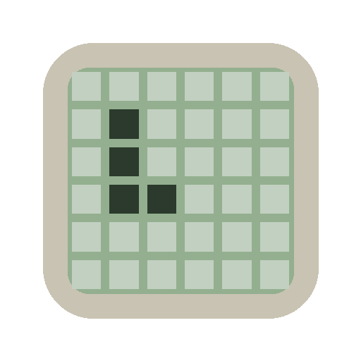

# BRICK GAME · 9999 IN 1

A Progressive Web App recreation of the classic 90s/2000s handheld **Brick Game** LCD devices.

**Play live:** https://ipaliog-a11y.github.io/handheld_g/



## Games

| | Game | What you do |
|---|------|-------------|
| ★ | **DAILY** | Today's game, same level, speed and random sequence for everyone |
| A | **BRICK** | Classic falling bricks: hold piece, ghost preview, combos |
| B | **BRICK B** | Falling bricks starting with garbage rows |
| C | **RACE** | Dodge the cars in three lanes |
| D | **SNAKE** | Eat and grow |
| E | **SHOOT** | Clear the descending blocks |
| F | **TANK** | Tank battle |
| G | **BREAK** | Brick breaker |
| H | **FROG** | Cross the road and the river |
| I | **STACK** | Stop the sliding row on top of the one below |
| J | **RUNNER** | Jump over blocks, duck under birds |
| K | **FILL** | Shoot blocks up to complete the rows creeping down |
| L | **PONG** | Paddle vs CPU |
| M | **INVADE** | Stop the marching aliens |
| N | **GEMS** | Match 3+ falling gems in any direction |
| O | **MAZE** | Eat all the dots, avoid the chasers |
| P | **RALLY** | Two-lane racing with fuel and turbo |

## Features

- Authentic handheld shell + LCD look, 5 colour themes (classic, green, grey, amber, blue)
- Level (1–9) + Speed (1–9) select
- Top-5 high score table per game with initials, plus a **Share** button on game over
- **Daily challenge**, stats page and 13 awards
- Touch, swipe, keyboard and **gamepad** controls
- Portrait and landscape layouts
- Game Boy-style pulse and noise sounds, plus vibration
- Full offline PWA (installable on phone)
- English + Greek language

## Controls

| Input | Action |
|-------|--------|
| D-pad / WASD / Arrows | Move / steer / menus |
| A button / Z / J | Rotate / fire / jump / OK (shown on the button) |
| B button / X / K | Drop / fire / back (shown on the button) |
| ▲ / C / Shift (brick games) | Hold piece |
| START / Enter / Space | Start / pause menu / confirm |
| SET / O / , | Settings (also from the pause menu) |
| RESET / R | Back to menu |
| SOUND / M | Toggle sound |
| Esc / P | Pause |

**Swipe** on the screen: drag to move, tap = A, flick down = hard drop in brick games.

**Gamepad:** d-pad/stick, A/Y = A, B/X = B, Start, Select = settings, shoulders = hold.

### Settings (SET button)

| Option | Description |
|--------|-------------|
| **BIG 3** | Large Down/Left/Right buttons while playing (touch-friendly). Default OFF |
| **REPEAT** | Hold a button to auto-repeat |
| **GHOST** | Landing preview of the falling piece |
| **THEME** | LCD colour theme |
| **SWIPE** | Swipe/tap controls on the screen |
| **BUZZ** | Vibration (Android) |
| **SOUND** | Beeps on/off |
| **LANG** | English / Ελληνικά |

## Install as app (phone)

1. Open the live link in Chrome / Safari
2. Tap **Add to Home Screen** / **Install**
3. Launch like a native app (fullscreen, offline)

## Tech

- Single-file HTML + Canvas, vanilla JS (no frameworks)
- Service Worker for offline (bump `CACHE_NAME` in `sw.js` when changing files)
- `localStorage` for scores, stats and settings
- VT323 pixel font

## Development

Open `index.html` or serve the folder:

```bash
npx serve .
```

Run the end-to-end tests (headless Chromium):

```bash
npm install
npx playwright install chromium
npm test
```

The tests also run on every push and pull request via GitHub Actions.

## License

MIT – made for fun and nostalgia.
